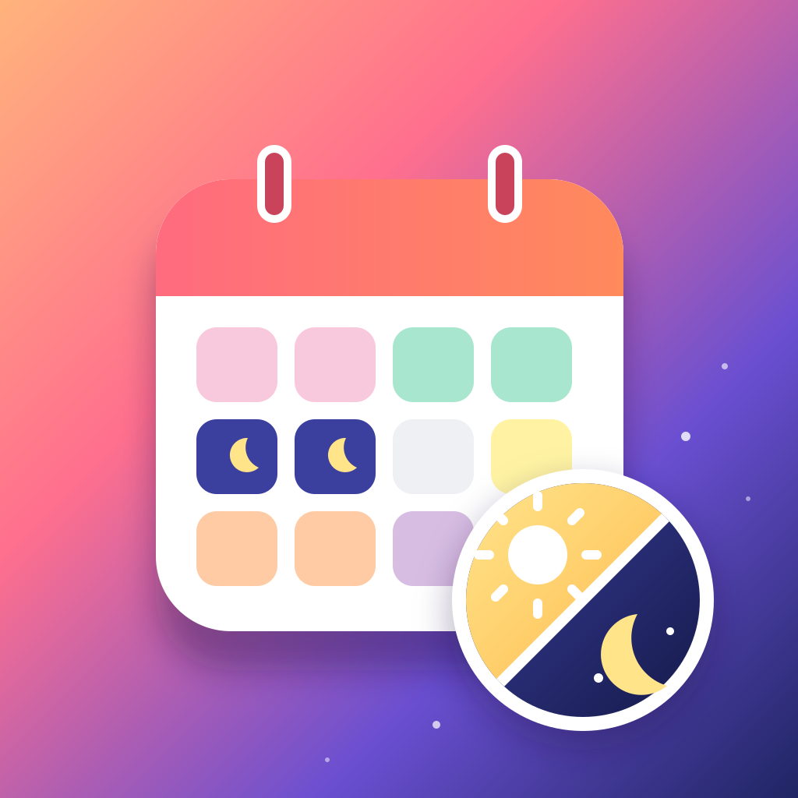

<p align="center">
  
</p>

<h1 align="center">nightshift</h1>

<p align="center">
  <em>Shifts, hours and overtime at a glance.</em>
</p>

<p align="center">
  <a href="https://github.com/SirOpolov/nightshift/releases/latest"></a>
  <a href="https://github.com/SirOpolov/nightshift/actions/workflows/build.yml"></a>
  
  
  <a href="https://pay.msero.de"></a>
</p>

---

A lightweight shift planner for the iPhone. No account, no cloud. Enter your shifts, read your hours.

- **Calendar with week numbers.** Month and year view, swipe to switch months.
- **Shifts by range.** Tap `+`, pick a shift, tap the first and the last day.
- **Your own shifts.** Name, description, start and end as you like. Vacation and Day off are always there.
- **Overtime.** Tap a day and enter hours and minutes. The day shows it in small print.
- **Statistics.** Hours worked and overtime per year, month and week, vacation days and a count per shift. A 30 minute break is deducted per work day, only days up to today count.
- **PDF export.** Yearly report to share, save or print.
- **English or German.** English by default, switch in **Settings → Language**.
- **Yours.** Light, dark or automatic, your own accent color, five font sizes.

## Install

Apple only runs signed apps. GitHub builds the app unsigned (`Nightshift.ipa`), it gets signed with an Apple ID while installing.

### 1. Download

1. Open the [latest release](https://github.com/SirOpolov/nightshift/releases/latest) (GitHub login required).
2. Download `Nightshift.ipa`.

Some messengers block `.ipa` files. Zip it before sending it.

### 2. Sign and install

| | Free Apple ID | Paid developer account (99 €/year) |
|---|---|---|
| Lasts | 7 days | 1 year |
| iPhone has to be at the computer | Yes | No, only the file goes back and forth |
| Needed | iPhone and `.ipa` | `.ipa` and the iPhone's UDID |

**Sideloadly (Windows, macOS)**

1. Install [Sideloadly](https://sideloadly.io). On Windows also install iTunes and iCloud directly from Apple, not from the Microsoft Store.
2. Connect the iPhone by cable, unlock it, tap **Trust**.
3. Drag `Nightshift.ipa` into the window, enter the Apple ID, click **Start**.
4. Enter password and verification code, wait for **Done**.

**Developer account:** Add the iPhone's UDID at [developer.apple.com/account](https://developer.apple.com/account) → **Devices**, sign the `.ipa` with a profile that contains this iPhone and install the signed file with Sideloadly. Sideloadly shows the UDID in the device info, iTunes shows it after clicking **Serial Number** a few times in the summary.

**iloader (Linux)**

```sh
sudo pacman -S usbmuxd && sudo systemctl start usbmuxd
```

Then start [iloader](https://github.com/nab138/iloader) as AppImage, sign in with the Apple ID and choose `Nightshift.ipa` as custom IPA. Not tested by me, use Sideloadly if in doubt.

### 3. Allow it once

1. **Settings → General → VPN & Device Management** → tap the developer app → **Trust**.
2. **Settings → Privacy & Security → Developer Mode** on. The switch only shows up after installing. The iPhone restarts, then tap **Turn On**.

## Updates

> [!IMPORTANT]
> 1. **Never delete the app.** All your shifts are gone with it.
> 2. **Always sign with the same Apple ID.** A different one installs a second app without your data.
> 3. **Install over the existing app.** Repeat steps 1 and 2, your data stays.

When the signature expires (7 days or 1 year) the app no longer opens, but the data is still there. Repeat step 2 with the same `.ipa` and the same Apple ID. A fixed day each week helps.

<details>
<summary>Troubleshooting</summary>

| Problem | Fix |
|---|---|
| App opens briefly and closes right away | Signature expired → repeat step 2. Or Developer Mode is off → step 3. |
| "Untrusted Developer" | Step 3, trust the developer. |
| "Developer Mode" switch is missing | Install the app first, then look again. |
| Sideloadly doesn't find the iPhone | Unlock it, tap **Trust**, try another cable, on Windows install iTunes from Apple. |
| Error about too many apps | A free Apple ID may only have 3 self signed apps at once. Delete one. |
| Error about too many App IDs | Free Apple IDs may only register a few new apps per week. Wait a few days. |
| Data gone after reinstalling | The app was deleted or signed with a different Apple ID. Always install over it, always with the same Apple ID. |

</details>

## Development

GitHub Actions generates the project with [XcodeGen](https://github.com/yonaskolb/XcodeGen), runs the tests and builds an unsigned `Nightshift.ipa` on every push to `main`. A `v*` tag publishes it as a release.

```sh
git tag v1.2 && git push origin v1.2
```

Texts are written in English in the code, German lives in `Nightshift/de.lproj`.

## Support

Buy me a coffee:

<p align="center">
  <a href="https://pay.msero.de"></a>
</p>

## License

[MIT](LICENSE)
